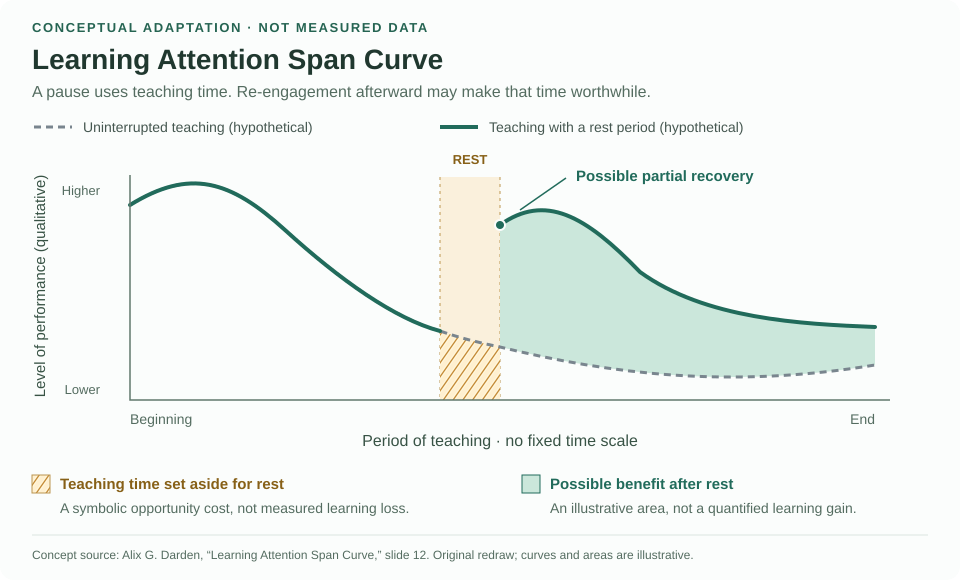
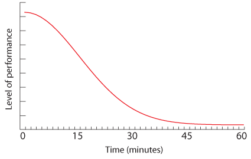
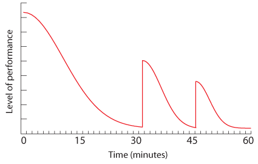
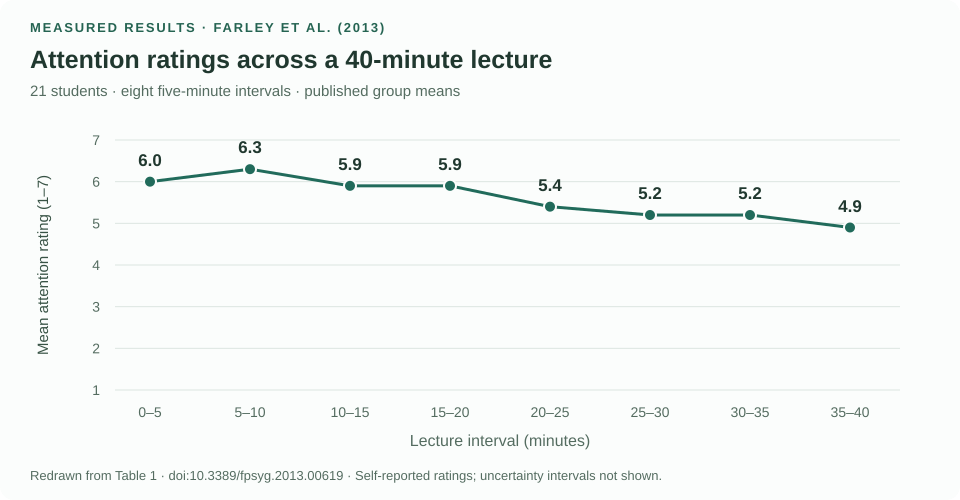
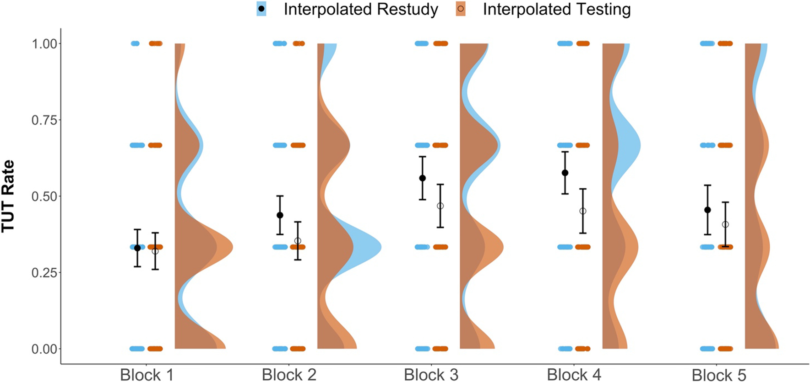
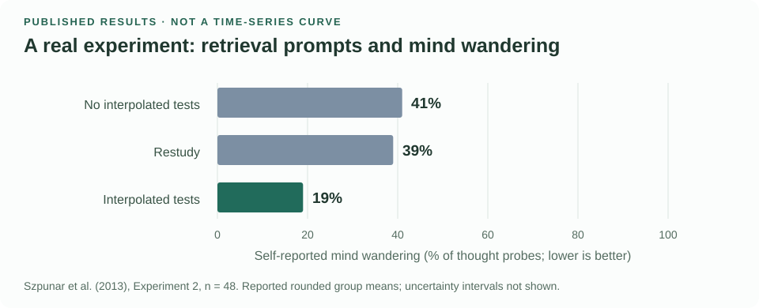

Attention Span &amp; Engagement in Long LecturesExplore the research, lecture breaks, games, quick quizzes &amp; Q&amp;A.

::: {.attention-section}
Teaching with attention in mind

### Pause the lecture. Keep the learning moving.

::: {.attention-lead}
Especially in lengthy lectures, plan opportunities to **retrieve, discuss, ask, play, and rest**. A quick quiz can reveal a misconception; a discussion can make reasoning visible; a genuine break can give students time away from the task. These activities serve different purposes—not one interchangeable “attention reset.”
:::

::: {.attention-caution}
**What the evidence does—and does not—say.** The familiar claim that everyone loses attention after 10–15 minutes has weak support. Attention varies with the learner, task and teaching context. Nor do the cited studies establish that every break restores attention to its maximum. [Wilson & Korn (2007)](https://journals.sagepub.com/doi/10.1080/00986280701291291)

**Two ways to understand the topic.** Start with conceptual illustrations of re-engagement, then examine what researchers actually measured. Attention ratings, mind-wandering reports, performance and learning are related, but they are not interchangeable measures of “attention span.”
:::

#### 1. The teaching idea: attention, breaks, and re-engagement {#attention-concepts}

**Conceptual illustrations—not measured attention curves.** A long stretch of listening can make attention harder to sustain. Purposeful changes of activity may help students re-engage; a genuine rest break offers time away from the task. Recovery need not be complete or the same after every interruption.

##### Understanding the “Learning Attention Span Curve” {#attention-learning-curve}

A rest period uses time that could have been spent teaching, but renewed engagement afterward might compensate for that time. This original conceptual redraw explains the trade-off illustrated in Alix G. Darden's faculty-development presentation.

<figure id="attention-rest-tradeoff">

<figcaption><strong>Conceptual adaptation · not measured data.</strong> Original diagram informed by Alix G. Darden's <a href="https://www.slideserve.com/daria-mcclure/alix-g-darden-ph-d-director-of-faculty-development-department-of-pediatrics-powerpoint-ppt-presentation">faculty-development presentation, slide 12</a>, “Learning Attention Span Curve.” Layout, wording and curves have been redrawn; no data were extracted. <a href="https://image3.slideserve.com/6847835/learning-attention-span-curve-l.jpg">View the source slide</a> · <a href="../assets/graphics/teaching-attention/learning-attention-span.svg">Open the new figure full size</a>.</figcaption>
</figure>

**How to read it:** amber hatching represents the teaching opportunity set aside during rest; green shading represents a possible benefit afterward. The source calls these “learning loss” and “learning gain,” but neither shaded area quantifies learning. The dashed curve is a hypothetical comparison, not a measured control group. No performance is estimated during the rest period.

Use this as an explanation of why a pause may be worthwhile, not a prediction of recovery size or proof of a particular break schedule. The qualitative performance axis preserves the source's distinction from a measured attention-span duration.

##### Continuous delivery and partial recoveries {#attention-auckland}

Auckland's paired diagrams illustrate a declining curve and progressively smaller rebounds. Their original vertical axis is **“Level of performance,” not attention span**. The timing and curve heights should not be read as measurements or an optimal break schedule. [View Auckland's teaching guidance](https://flexiblelearning.auckland.ac.nz/teaching-large-classes/2.html).

<figure>
<h6>One continuous stretch</h6>

</figure>
<figure>
<h6>Partial recoveries</h6>

</figure>

Original graphics reproduced unchanged. © University of Auckland, <a href="https://flexiblelearning.auckland.ac.nz/teaching-large-classes/2.html">Teaching large classes: Engaging your audience</a>. Included for non-profit educational comparison; see the University's <a href="https://www.auckland.ac.nz/en/copyright.html">copyright conditions</a>.

::: {.attention-reading-guide}
**Use the idea, not a stopwatch rule.** Plan opportunities for a Quick Quiz (QQ), discussion, learning game, Q&A, or rest, and adjust the pace to students' responses, task difficulty and accessibility needs. In shorter classes, choose fewer activities. Clarify confusion when it appears, even before a planned pause.

**Keep the distinction clear:** quizzes and discussions are active learning; they still require mental effort. Rest offers relief from academic work. Auckland cites Johnstone & Percival (1976) for its timing advice, but provides no dataset or methods establishing these exact curves or the effects of specific activities.
:::

#### 2. What researchers measured {#attention-measured-evidence}

These studies provide numerical observations. Each measures a different aspect of engagement, so their values should not be combined into a single universal attention curve.

##### Attention ratings across a 40-minute lecture

Farley, Risko, and Kingstone (2013) asked **21 students** to rate their attention over each preceding five-minute interval. This plot uses the eight published means from **Table 1**, without smoothing or invented values. [Read the study](https://www.frontiersin.org/journals/psychology/articles/10.3389/fpsyg.2013.00619/full).

<figure id="attention-farley">

<figcaption><strong>Measured results · redrawn from Table 1.</strong> Farley, Risko &amp; Kingstone (2013), <em>Frontiers in Psychology</em>, 4:619. Points are group means; lines only connect adjacent intervals. Uncertainty intervals are not plotted. This small, self-report study does not establish a universal attention deadline.</figcaption>
</figure>

View the published values and measurement scale

Ratings range from **1 (strongly disagree)** to **7 (strongly agree)** with the statement “My attention is fully focused on the video.” Each rating summarizes the preceding interval, not one instant.

| Lecture interval (minutes) | Mean attention rating | Standard deviation |
|:---|---:|---:|
| 0–5 | 6.0 | 1.0 |
| 5–10 | 6.3 | 1.0 |
| 10–15 | 5.9 | 1.0 |
| 15–20 | 5.9 | 0.7 |
| 20–25 | 5.4 | 1.1 |
| 25–30 | 5.2 | 1.1 |
| 30–35 | 5.2 | 1.2 |
| 35–40 | 4.9 | 1.0 |

Source: [Farley et al., Table 1](https://www.frontiersin.org/journals/psychology/articles/10.3389/fpsyg.2013.00619/full#T1). Standard deviations describe variation among students, not uncertainty in the mean.

::: {.attention-reading-guide}
**Finding:** mean attention ratings rose initially, then generally declined from 6.3 in the second interval to 4.9 in the last.

**Teaching implication:** check engagement throughout a lecture rather than assuming it stays constant.

**Limitation:** 21 students rated their own attention during one video lecture. There was no comparison of break schedules, and the results do not identify a universal attention deadline.
:::

##### Quizzes versus restudy between lecture segments

Welhaf et al. (2022) studied **195 students** watching a roughly 50-minute statistics lecture. This is their **original Figure 4**, comparing mind-wandering reports across five blocks, with testing or restudy between segments. [Read the study](https://link.springer.com/article/10.1186/s41235-022-00372-y#Fig4).

<figure id="attention-welhaf">

<figcaption><strong>Published figure · reproduced unchanged.</strong> Welhaf, Phillips, Smeekens, Miyake &amp; Kane (2022), Figure 4, <em>Cognitive Research: Principles and Implications</em>, 7:26. © The authors, <a href="https://creativecommons.org/licenses/by/4.0/">CC BY 4.0</a>. <a href="../assets/graphics/teaching-attention/welhaf-2022-figure-4.png">Open full-size figure</a>.</figcaption>
</figure>

::: {.attention-reading-guide}
**How to read it:** TUT means *task-unrelated thought*; lower is better. Blue represents restudy, orange represents testing. Small dots show students' rates, larger filled/open circles show means, and bars are 95% confidence intervals. The shaded shapes show the distributions.

**Finding:** testing modestly reduced overall mind-wandering compared with restudy.

**Teaching implication:** the activity between lecture segments may matter, not just the interruption itself.

**Limitation:** evidence was mixed across statistical approaches. The study did not establish different time-course trajectories or repeated recovery after each interruption. Both groups had activities between segments; this was not a breaks-versus-no-breaks comparison.
:::

##### Why include quick quizzes? {#attention-quick-quizzes}

Szpunar, Khan, and Schacter studied a 21-minute statistics video. In Experiment 2, participants receiving interpolated tests reported less mind wandering than the comparison groups. **All groups had interruptions**: this was not simply “breaks versus no breaks.” [Read the paper and Figure 2B](https://pmc.ncbi.nlm.nih.gov/articles/PMC3631699/).

<figure>

<figcaption>Original plot of reported group means. Self-reported mind wandering is not an attention-span duration. This small video-lecture experiment does not validate the conceptual curves above.</figcaption>
</figure>

::: {.attention-reading-guide}
**Finding:** Experiment 2's reported mind-wandering means were 19% with interim quizzes, 39% with restudy, and 41% without interim quizzes.

**Teaching implication:** ask students to recall an idea before displaying its answer. A low-stakes quiz can serve this purpose during a lecture.

**Limitation:** this experiment included 48 participants watching a 21-minute video. The percentages summarize thought-probe reports, not percentages of inattentive students or measured attention-span durations. The results do not establish recovery after every kind of break.
:::

On a small screen, swipe a wide plot sideways to read it completely. The chart regions also support keyboard scrolling.

#### Choose the interruption for the learning purpose

<article><h5>Quick Quiz · retrieve</h5>
Ask one low-stakes question before showing the answer. Let everyone respond individually, then explain the reasoning. Use the pattern of answers to decide whether to continue or reteach.
</article>
<article><h5>Discussion · explain</h5>
Give a concrete prompt: “Which explanation fits, and why?” Include quiet thinking time, pair discussion, then a short debrief. Offer a written alternative to speaking aloud.
</article>
<article><h5>Learning game · apply</h5>
Try a prediction challenge, concept match, or “spot the error.” Tie the game to a course objective. Reward reasoning and feedback, not speed alone; avoid mandatory public rankings.
</article>
<article><h5>Q&amp;A · diagnose</h5>
Collect questions throughout the lecture, including anonymous or written submissions. Ask students to name the least clear step instead of relying only on “Any questions?”
</article>
<article><h5>Rest break · recover</h5>
Make this a genuine pause from academic work. Offer water, quiet rest, or optional movement without requiring standing. A quiz or discussion is active learning, not necessarily rest.
</article>
<article><h5>Re-entry · reconnect</h5>
State the question the next segment will answer, connect it to the preceding activity, and check understanding. A lively room is not by itself evidence that everyone has learned.
</article>

These are **practical teaching suggestions**, not experimentally established effect sizes for each activity. A large STEM meta-analysis supports active learning for achievement, but does not supply minute-by-minute attention curves or prove that every game or Q&A format works equally well. [Freeman et al. (2014)](https://doi.org/10.1073/pnas.1319030111)

For genuine rest, a meta-analysis found small benefits of micro-breaks for vigor and fatigue; the overall performance effect was not statistically significant. Its work-task evidence is not a direct estimate of classroom attention recovery. [Albulescu et al. (2022)](https://journals.plos.org/plosone/article?id=10.1371/journal.pone.0272460)

Research and teaching sources: how they are used here

1. **Wilson, K., & Korn, J. H. (2007).** *Attention during lectures: Beyond ten minutes.* Teaching of Psychology, 34(2), 85–89. [DOI: 10.1080/00986280701291291](https://doi.org/10.1080/00986280701291291). Review informing the caution against a universal attention deadline.
2. **Szpunar, K. K., Khan, N. Y., & Schacter, D. L. (2013).** *Interpolated memory tests reduce mind wandering and improve learning of online lectures.* PNAS, 110(16), 6313–6317. [DOI: 10.1073/pnas.1221764110](https://doi.org/10.1073/pnas.1221764110). Source for the empirical bar chart, not for the conceptual curves.
3. **Freeman, S., et al. (2014).** *Active learning increases student performance in science, engineering, and mathematics.* PNAS, 111(23), 8410–8415. [DOI: 10.1073/pnas.1319030111](https://doi.org/10.1073/pnas.1319030111). Meta-analysis of achievement and failure outcomes, not attention duration.
4. **Albulescu, P., et al. (2022).** *“Give me a break!” A systematic review and meta-analysis on the efficacy of micro-breaks for increasing well-being and performance.* PLOS ONE, 17(8), e0272460. [DOI: 10.1371/journal.pone.0272460](https://doi.org/10.1371/journal.pone.0272460). Evidence about recovery between tasks; distinct from instructional activities.
5. **Farley, J., Risko, E. F., & Kingstone, A. (2013).** *Everyday attention and lecture retention: the effects of time, fidgeting, and mind wandering.* Frontiers in Psychology, 4:619. [DOI: 10.3389/fpsyg.2013.00619](https://doi.org/10.3389/fpsyg.2013.00619). Table 1 supplies the attention-rating means and standard deviations used above.
6. **Welhaf, M. S., Phillips, N. E., Smeekens, B. A., Miyake, A., & Kane, M. J. (2022).** *Interpolated testing and content pretesting as interventions to reduce task-unrelated thoughts during a video lecture.* Cognitive Research: Principles and Implications, 7:26. [DOI: 10.1186/s41235-022-00372-y](https://doi.org/10.1186/s41235-022-00372-y). Original Figure 4 reproduced under CC BY 4.0; no changes.
7. **University of Auckland.** [*Teaching large classes: Engaging your audience*](https://flexiblelearning.auckland.ac.nz/teaching-large-classes/2.html). Teaching guidance, not a peer-reviewed study; source of the unchanged conceptual diagrams. Its timing advice cites Johnstone, A. H., & Percival, F. (1976), *Attention breaks in lectures*, Education in Chemistry, 13, 49–50; the diagrams' exact curves are not verified measurements here.
8. **Darden, A. G.** [*The Intersection of Research and Teaching*](https://www.slideserve.com/daria-mcclure/alix-g-darden-ph-d-director-of-faculty-development-department-of-pediatrics-powerpoint-ppt-presentation), faculty-development presentation, slide 12, “Learning Attention Span Curve.” Source of the rest-versus-teaching-time idea in our original conceptual adaptation. Layout, labels and curves are redrawn; no measured data are implied. The source slide remains linked for comparison.

**The teaching principle:** give students recurring opportunities to do something meaningful with an idea, and give them genuine opportunities to rest. Use their responses to guide the pace; do not treat a stopwatch as a measure of attention.
:::

