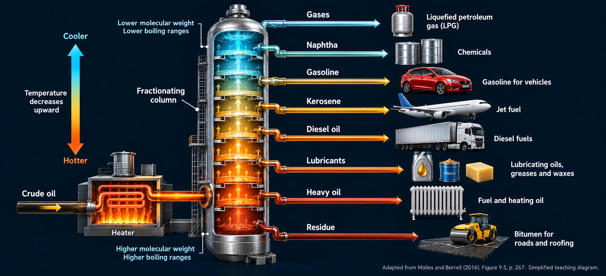
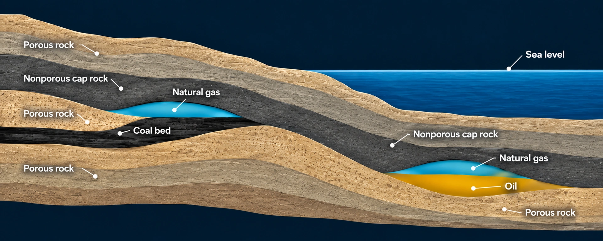
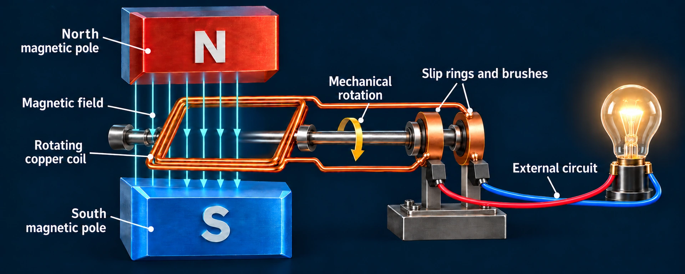
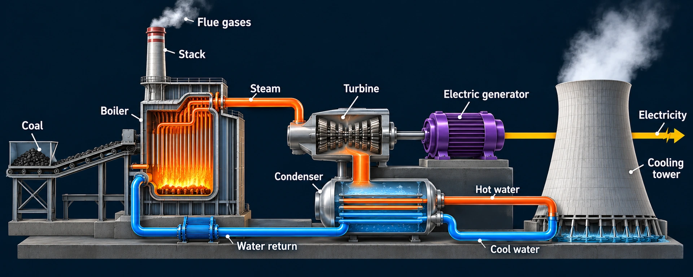
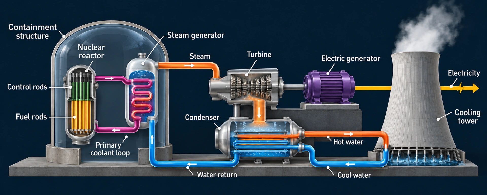
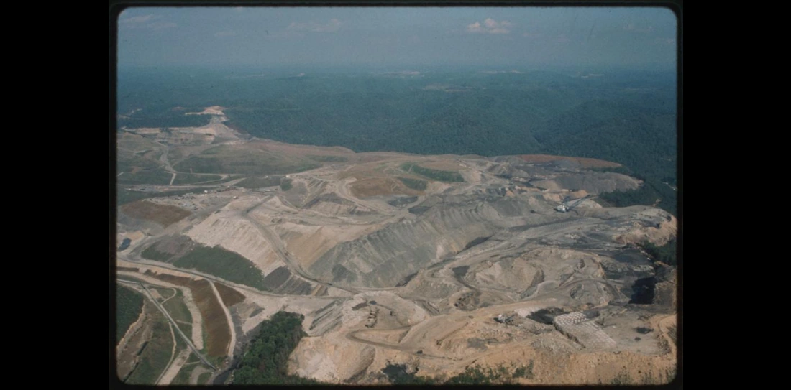
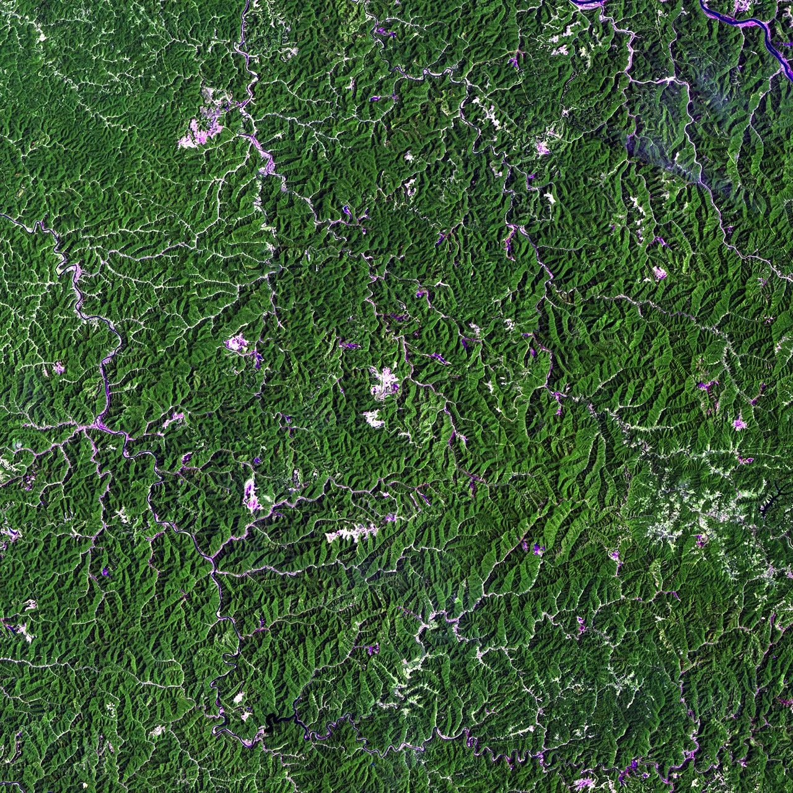
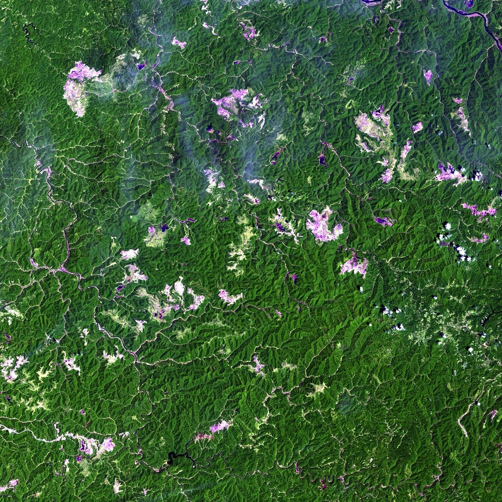
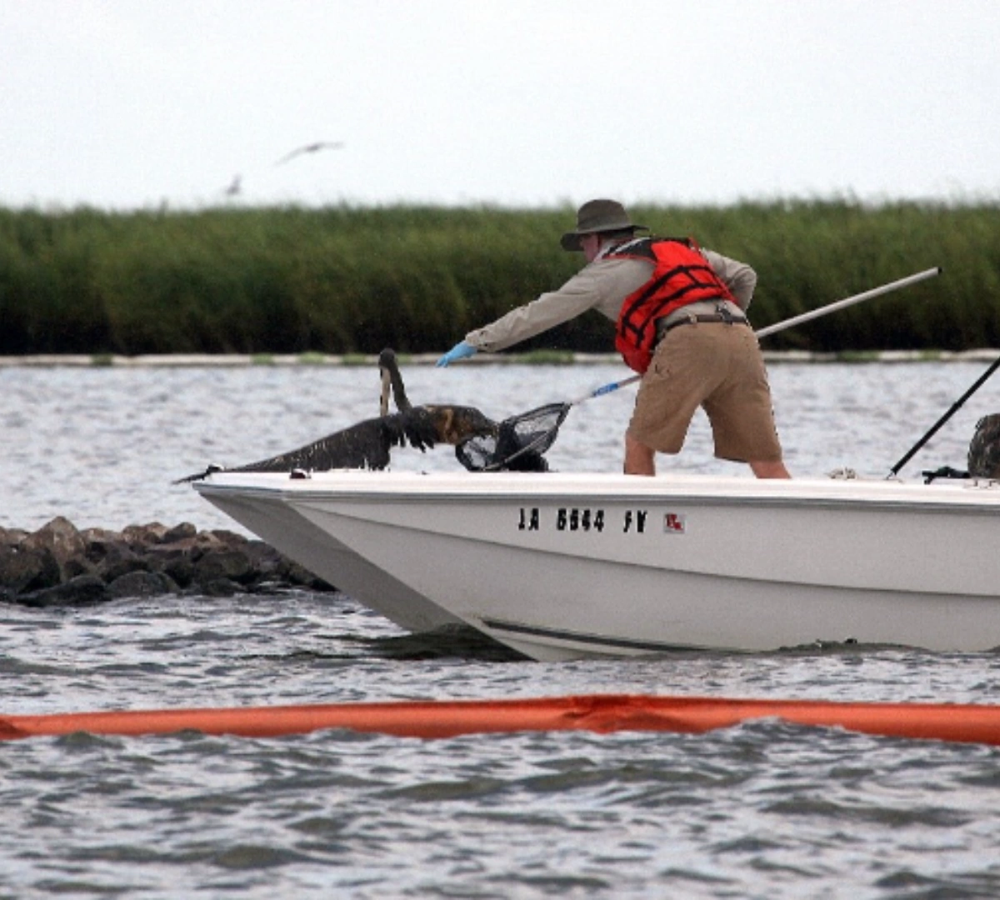

Chapter 09 · Interactive course<h2>Follow the energy. Account for the consequences.</h2>
Learn the science. Run the experiments. Build an evidence-based energy decision.

::: {.energy-actions}
[Start the lesson](#chapter-overview)
[See the figures](#chapter-figures)
[Run the energy experiment](#energy-conversion-lab)
[Open my notebook](#my-notebook)
[Slides and teaching resources](#teaching-resources)
[Practice in the Exam Center](../../exam-center/)
:::

This is the **complete student lesson**, not a slide deck. Read, investigate and return to difficult ideas at your own pace. The separate presentation summarizes the chapter for a 50-minute lecture. No installation, account, paid API, or physical equipment is required for the webpage activities.

The textbook's central question, Science, Issues and Solutions sections guide the complete reading below. Your task is to connect a physical mechanism to an environmental consequence, not simply label a technology “good” or “bad.” [Begin the chapter reading](#chapter-overview) or use the investigation shortcuts below.

<nav class="lesson-map" aria-label="Chapter 9 learning modules">
<a href="#chapter9-science">01 · Understand<strong>Read the complete chapter</strong><small>Science, Issues, Solutions and takeaways.</small></a>
<a href="#energy-conversion-lab">02 · Experiment<strong>Account for every unit</strong><small>Manipulate a thermal energy balance.</small></a>
<a href="#decay-lab">03 · Investigate<strong>Change through time</strong><small>Fission, half-life and continuing decay.</small></a>
<a href="#issues-compare-complete-pathways">04 · Evaluate<strong>Follow the impacts</strong><small>Boundaries, exposure and restoration.</small></a>
<a href="#riverton">05 · Apply<strong>Advise a community</strong><small>Defend a decision and revise it.</small></a>
<a href="#chapter-check">06 · Reflect<strong>Test your understanding</strong><small>Feedback and an experiment notebook.</small></a>
</nav>

## Figures from Chapter_9.pptx {#chapter-figures}

These are the figures from **Chapter_9.pptx**, incorporated into the full lesson below. Select a thumbnail to jump to its explanation, caption and enlarged view. The original animated experiments remain available alongside the reading.

<nav class="chapter-figure-index" aria-label="Chapter 9 figures">
<a href="#figure-refinery">Oil refining · Figure 9.5</a>
<a href="#figure-gas-deposits">Natural gas, oil and coal beds</a>
<a href="#figure-generator">Electrical generator</a>
<a href="#figure-fossil-power">Electricity from fossil fuels</a>
<a href="#figure-nuclear-power">Nuclear electricity generation</a>
<a href="#figure-mountaintop-mining">Mountaintop-removal mining</a>
<a href="#figure-mining-1987">Mining footprint · 1987</a>
<a href="#figure-mining-2011">Mining footprint · 2011</a>
<a href="#figure-oil-spill-response">Oil-spill wildlife response</a>
</nav>

## What you will learn

By the end of the chapter, you should be able to:

1. Trace the transformations linking a primary energy resource to a useful service.
2. Explain how fossil combustion and nuclear fission generate heat.
3. Distinguish operational impacts from impacts across the life cycle.
4. Evaluate a choice using environmental mechanisms, affected communities, and uncertainty.
5. Calculate an energy balance and the expected fraction remaining after successive half-lives.

**Before you begin:** a percentage is a fraction of 100; multiplying a rate by time gives an amount. If these ideas feel unfamiliar, the worked examples below walk through the calculations. Write a one-sentence initial answer: “When a power plant is 35% efficient, the other 65% ___.” Revisit it after Experiment 9.1.

**Reading:** the complete Chapter 9 in the supplied chapter PDF: Science (printed pp. 264–274), Issues (274–284), Solutions (284–291), summary and review (292–293).



## Science: resources become services

### Energy is an amount; power is a rate

A kilowatt-hour (kWh) measures energy. A kilowatt (kW) measures the rate of energy transfer. A 1 kW appliance operating for 2 hours uses 2 kWh. At larger scales, a generator delivering 100 MW steadily for 3 hours supplies 300 MWh.

$$
\text{Energy}=\text{power}\times\text{time}
$$

Coal, crude oil and uranium are primary resources. **Electricity is an energy carrier.** The service may be lighting, refrigeration, transportation or comfortable indoor temperatures. Providing the same service with less energy is an efficiency improvement.

### Fossil fuels contain ancient chemical energy

Coal commonly originates in plant material accumulated in ancient wetlands. Burial, pressure and heat alter this material over geological time. Much petroleum originates in ancient aquatic organisms buried in sediments. Natural gas consists predominantly of methane and can occur with oil or coal or in other geological formations.

The original organisms captured energy through photosynthesis. Geological processes transformed their remains into concentrated fuels. These resources are nonrenewable because formation is much slower than consumption on human timescales.

Refining separates crude oil into fractions with different boiling ranges. Oil therefore supplies multiple products, including transport fuels, lubricants and chemical feedstocks. An electricity-only comparison does not describe every use of petroleum. [Textbook, pp. 265–269.]

### Thermal generation converts heat into electricity

In a steam-cycle plant, heat produces steam, steam turns a turbine, and the turbine drives a generator. A condenser and cooling system remove rejected heat and allow the working fluid to circulate. Gas turbines can use hot combustion gases directly; combined-cycle plants also recover exhaust heat.

The book's approximate **35% conversion efficiency** supplies a useful classroom example:

$$
100\ \text{energy units in}=35\ \text{units of electricity}+65\ \text{units of heat}
$$

Energy does not disappear. Some leaves in forms that the plant cannot convert into useful electricity. This value is a teaching approximation from the text, not a universal performance claim about modern power plants. [Textbook, p. 271.]

Check your understanding: what happens with 200 input units?

At the same assumed efficiency, useful electricity is $200\times0.35=70$ units. The remaining 130 units leave as heat. Efficiency describes this conversion; it does not measure every environmental impact.

### Compare the same useful output

Comparing equal fuel inputs can hide a useful question: how much input is required to deliver **100 units of electricity**?

At 35% efficiency, input is $100/0.35\approx285.7$ units; rejected heat is approximately 185.7 units. At 40%, input is 250 and rejected heat is 150. The input reduction is $(285.7-250)/285.7\approx12.5\%$.

This is a comparison at equal service, not a claim that total environmental damage falls by 12.5%. That would require information about the fuels, extraction, emissions and affected ecosystems. **Conservation tells us where energy goes; environmental assessment tells us why the pathway matters.**

## Nuclear energy: a controlled chain reaction

### Nuclear fission supplies a different source of heat

Fission splits heavy atomic nuclei, releasing energy and neutrons. In a reactor, engineers control the chain reaction and transfer heat to a power cycle.

For a common water-moderated reactor:

| Component | Function | Why it matters |
|---|---|---|
| Fuel | Contains fissile material | Supplies nuclear energy |
| Moderator | Slows neutrons | Affects the probability of subsequent fission |
| Control rods | Absorb neutrons | Regulate or stop the chain reaction |
| Coolant | Removes heat | Transfers energy and protects fuel |
| Containment | Provides a protective barrier | Limits potential releases |

Designs vary, and water can serve as both moderator and coolant. Fission differs from fusion, which combines light nuclei. [Textbook, p. 273; [NRC explanation](https://www.nrc.gov/reading-rm/basic-ref/students/what-is-nuclear-energy).]

**Shutdown does not mean immediate cooling.** Radioactive fission products continue releasing decay heat. Cooling remains necessary after the chain reaction stops. The historical Fukushima case shows how loss of power and cooling can combine into a serious accident. Different reactor designs and accident sequences must not be treated as interchangeable. [Textbook, pp. 283, 289; [NRC decay-heat glossary](https://www.nrc.gov/regulations-legislation/fact-sheets-brochures/backgrounder-on-the-three-mile-island-accident).]

### Fission and radioactive decay are not the same process

In a chain reaction, neutrons from one fission can contribute to subsequent fissions. Neutron absorption helps control that chain. Radioactive decay is the spontaneous transformation of an unstable nucleus. Existing radioactive products do not stop transforming merely because the chain reaction has stopped.

For a single isotope, a **half-life** is the time over which the expected number of parent nuclei falls by one-half. It is not the time until all the material is gone. After one, two and three half-lives, the expected parent fractions are $1/2$, $1/4$ and $1/8$. See the [NRC definition of radiological half-life](https://www.nrc.gov/education-regulatory-research/glossary/half-life-radiological).

## Experiment 9.2: half-life is a repeated fraction {#decay-lab}

**Question:** If half the parent nuclei transform in one half-life, will the other half all transform in the next?

**Predict.** Begin with 256 imaginary parent nuclei and a four-model-year half-life. Predict the expected count at years 4, 8 and 12. Do not use subtraction by a constant amount; consider what “half of what remains” means.

Without JavaScript, halve 256 repeatedly: 256 → 128 → 64 → 32. The interactive model animates these expected counts and lets you change the half-life and elapsed time.

**Investigate.** Advance one half-life at a time. Then keep elapsed time at 8 model years and compare half-lives of 2, 4 and 8 model years. Record which variable you changed and which you held constant. Use the notebook below to explain the pattern.

Worked results and the important limitation

With a four-year half-life, expected counts are 128 at year 4, 64 at year 8 and 32 at year 12. At the same elapsed time of eight years, half-lives of 2, 4 and 8 years leave expected counts of 16, 64 and 128 respectively.

Individual nuclei decay randomly, so a real collection need not follow these exact integer counts. The display rounds an expected value to illustrate the pattern. Its invented isotope does not represent reactor fuel, a waste mixture or a safe handling interval. Daughter products may also be radioactive. Hazard depends on more than the fraction of original parents remaining.

The connection to shutdown is qualitative: radioactive transformation can continue after fission stops. **Do not use this single-isotope curve as a reactor cooling or decay-heat prediction.**

## Issues: compare complete pathways

A fair comparison states what it includes: extraction, processing, transport, generation, delivery, waste and decommissioning. It also specifies the useful output being compared.

| System | Climate pathway | Other important burdens |
|---|---|---|
| Coal | Carbon dioxide from combustion | Mining disturbance, air pollutants, ash and cooling water |
| Natural gas | Combustion CO₂ and upstream methane leakage | Water management, leakage and infrastructure |
| Nuclear | Low operational combustion emissions; upstream impacts still exist | Uranium extraction, cooling, radioactive waste and decommissioning |

This table identifies mechanisms, not numerical rankings. Quantitative comparisons need consistent units, boundaries, locations and dates. [Textbook, pp. 277–289.]

### An impact can move between places and forms

Coal extraction can change drainage, habitats and water chemistry. Capturing pollutants at a plant can move contaminants into ash or another residual stream requiring management. Oil spills can affect coastal ecosystems, but chronic releases also matter. Hydraulic fracturing involves water acquisition, chemical handling, injection, flowback, treatment and disposal; each stage creates potential exposure pathways.

A **hazard** is a potential source of harm. **Risk** depends on exposure, likelihood and consequences under particular conditions. Identifying a hazard is the beginning of an assessment, not a complete estimate of risk.

### Build a source–pathway–receptor explanation

“Pollution is bad” identifies a concern but not a mechanism. A stronger explanation connects a **source** (for example, mine drainage), a **pathway** (movement through surface water), a **receptor** (an aquatic community or water user), and an **effect** that can be investigated. A safeguard should interrupt the pathway or reduce the source; monitoring should test whether it works.

Try the same structure for cooling-water discharge: thermal generation rejects heat, a water body may receive some of that heat, local conditions influence exposure, and temperature-sensitive organisms may be affected. The presence of a cooling system alone does not establish the size of that effect. You would need discharge characteristics, receiving-water conditions, biological evidence and a comparison condition.

**Mini-investigation:** choose one row in the comparison table. Write one source–pathway–receptor chain and name a measurement that could support or challenge it. Keep climate effects separate from local air or water effects; they do not have identical mechanisms or spatial scales.

Nuclear power adds the need to manage radioactive materials over appropriate timescales. The book's uranium-mining discussion also illustrates unequal burdens on communities. Its evidence about miners should not be casually generalized to every nearby resident. [Textbook, pp. 277–283.]

## Solutions: prevention and recovery

Oil-spill prevention, containment booms and skimmers act at different points in a release. Dispersants alter the distribution of oil and require their own impact assessment. None guarantees full restoration of the original ecosystem.

For mined land, replacing topsoil and establishing vegetation can restore functions. Yet productive grassland, original biodiversity and a reconstructed peat wetland are different outcomes. Define success before measuring it: water quality, native species, habitat connectivity, soil condition or a specified land use. The book contrasts restoration in the Powder River Basin with the difficulty of replacing slow-forming peat systems. [Textbook, pp. 285–287.]

For nuclear facilities, improvements include robust cooling, multiple protective barriers, planning for combined hazards, and passive systems that use physical processes such as gravity. These reduce risks without making every conceivable failure impossible. [Textbook, pp. 289–291.]

## Classroom activity: Riverton's energy decision {#riverton}

**Fictional scenario.** Riverton must replace an aging coal electricity contract in two years. Its council requires reliable service and wants lower pollution. The budget is **10 tokens**. These tokens are invented constraints, not actual prices, emissions factors or technology rankings.

Work in teams of three or four. Assign an analyst, a community advocate and a spokesperson. Choose a plan and write the reasoning on paper.

| Option | Tokens | Availability in the scenario | Conditions and concerns |
|---|---:|---|---|
| A. Extend the coal contract | 5 | Immediately | Continues combustion and upstream mining/ash burdens |
| B. Contract gas generation | 7 | Within two years | Evaluate methane management and continuing CO₂ emissions |
| C. Contract existing nuclear supply | 9 | Offered within two years | Verify the contract, waste stewardship and cooling constraints |
| D. Efficiency package | 1 | Within one year | Reduces demand by 10% in this scenario; does not supply the remaining energy |

**Rules:** select exactly one supply option (A, B or C), with optional D. Stay within 10 tokens. All three supply contracts initially meet the fictional service requirement. No option qualifies solely because it is cheapest.

Your recommendation must state:

1. The selected plan and token total.
2. One burden reduced and one retained.
3. Who receives benefits and who bears a remaining burden.
4. A safeguard and the evidence needed to evaluate it.

Stress card: reveal after the initial recommendation

The offered nuclear supply contract will not be available before the coal contract expires. This is a procurement delay in the fictional case, not a general nuclear construction-time assumption. Revise the sequence or justify a temporary bridge. Specify when and on what evidence the council should review the bridge.

Instructor guide and possible answers

A+D costs 6, B+D costs 8, and C+D costs 10. All satisfy the original budget. C+D can be defended as reducing operational fossil combustion while retaining uranium, cooling and waste obligations. It becomes unavailable by the deadline after the stress card. A temporary A+D or B+D plan can be defended only with acknowledged continuing burdens and a clear review condition. There is no unique numerical optimum because the exercise supplies no quantified environmental scores.

For a seminar activity, allow time to introduce the case, choose a plan, reveal the stress card, revise and compare recommendations. Extend the discussion as needed. The presentation has its own 50-minute timing.

**Rubric, 8 points:** correct mechanism (2), consistent comparison (2), affected community and safeguard (2), response to uncertainty and timing (2). Reward a defensible revision rather than loyalty to an initial answer.

## Check your understanding {#chapter-check}

Enable JavaScript for the five-question check with immediate explanations. The review questions below also work without JavaScript.

## Your investigation record {#my-notebook}

On paper, record a prediction, at least two trials with controls and units, an explanation, and one model limitation. The interactive notebook provides a text-file download.

**Completion task:** submit or retain a short scientific explanation—not a screenshot alone. Include one numerical energy balance, one half-life comparison, and one source–pathway–receptor example. Identify which results came from a simplified model and which evidence would be needed for a real decision. Your instructor will specify whether and where work should be submitted; this page does not collect it.

## Review and exit ticket

1. Is a visible cooling-tower plume a direct measure of CO₂ emissions?

No. The visible plume is generally condensed water droplets. Fuel use and measured emissions provide evidence about CO₂. A visual observation alone does not establish the emissions rate.

2. Why can a nuclear plant need cooling after shutdown?

Decay of radioactive fission products continues to produce heat after the chain reaction stops. Operators must continue removing that heat.

3. Does replanting a mine prove complete restoration?

No. The conclusion depends on the reference condition, the functions measured and the time allowed. Vegetation cover alone does not establish recovery of biodiversity or hydrology.

**Final reflection:** trace an energy pathway, explain one fossil–nuclear tradeoff, and name a measurement that could change your recommendation. Return to the chapter's central question and revise your initial answer.

## Slides and teaching resources {#teaching-resources}

::: {.course-resources}
The browser preview shows the latest student slides as still images. Download the PowerPoint for its embedded animations. The webpage experiments remain interactive.
The complete course above can be used independently of the slides. The student presentation summarizes the central question, science, issues, solutions and takeaways for a 50-minute lecture, with games and prediction/reveal sequences.

[Preview slides](slides/index.html?v=20261020-c26234c9cd01) · [Chapter_9.pptx](downloads/Chapter_9.pptx?v=20261020-c26234c9cd01) · [Practice in the Exam Center](../../exam-center/) · [Browse the chapter courses](../../chapters/)
:::

## Sources and further study

Primary source: Manuel Molles and Brendan Borrell, *Environment: Science, Issues, Solutions* (W. H. Freeman, 2016), Chapter 9, **Fossil Fuels and Nuclear Energy**. The complete 34-page chapter PDF compiled from the supplied photographs was checked in printed-page order. References use book page numbers, not positions in the earlier out-of-order whole-book scan. The opening spread and final review sheet include unprinted folios. Explanations here are original teaching summaries; official numbered section titles are retained.

Historical statistics, predictions about resource peaks, project plans and regulations in the book should not be read as current conditions. This lecture concentrates on mechanisms and identifies fictional activity data explicitly. See the NRC links above for reactor functions and decay heat.

The original conceptual artwork illustrates an imagined energy landscape. It does not depict a particular community or facility.

[Back to all lectures](../) · [Chapter 10: Renewable Energy](../guest-lecture-02-renewable-transition/)

