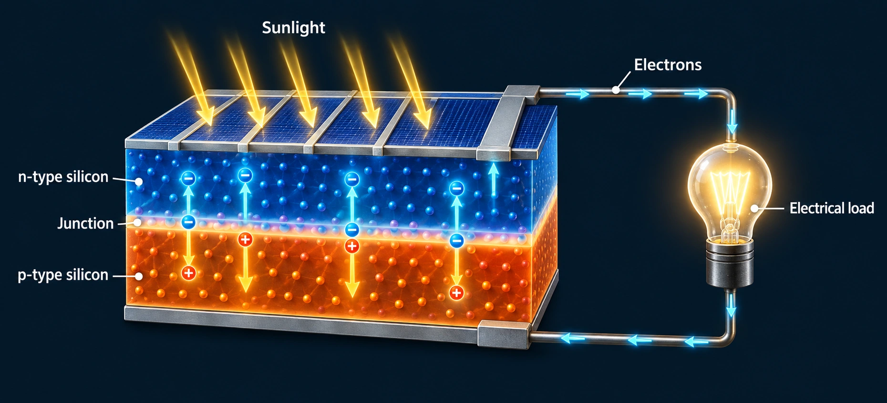
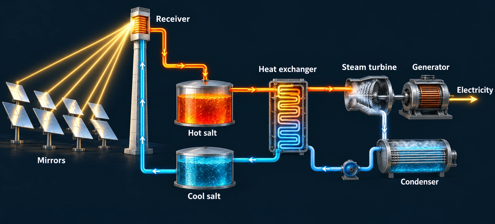
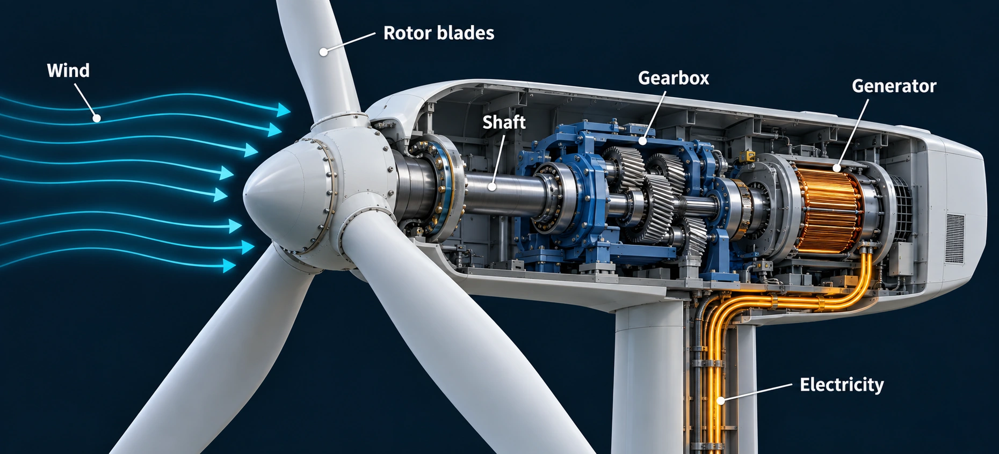
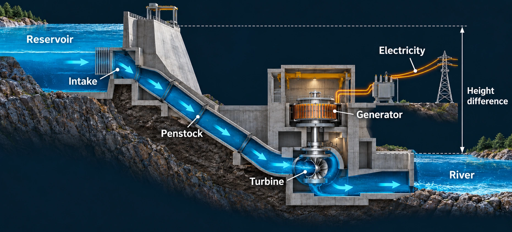
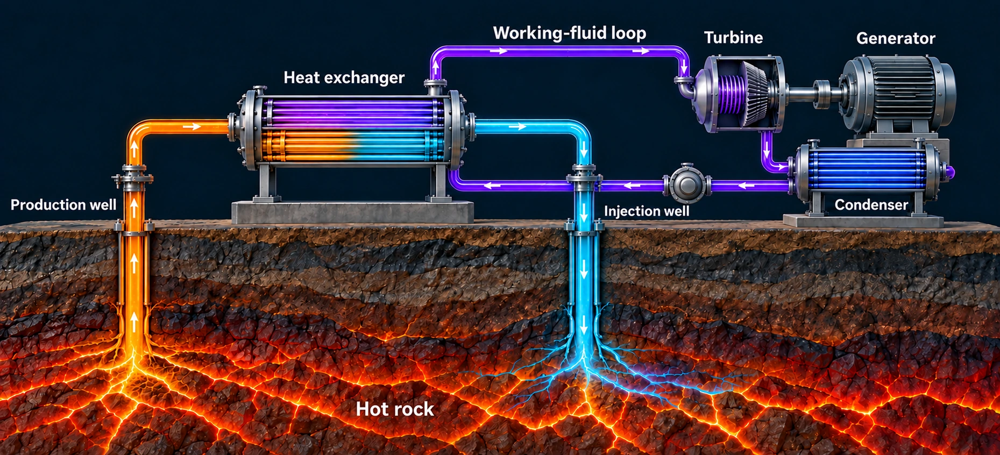
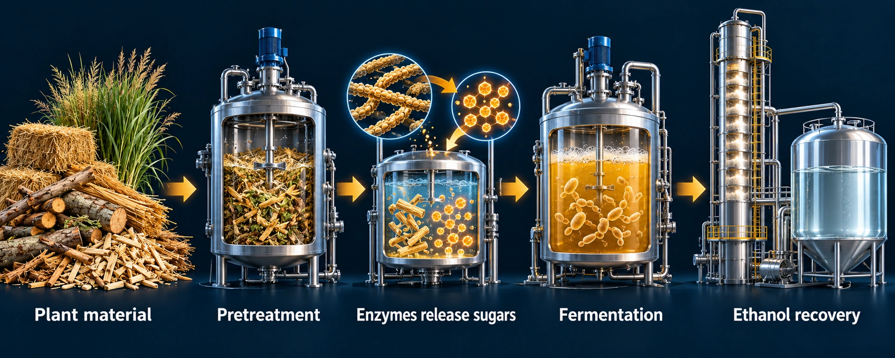
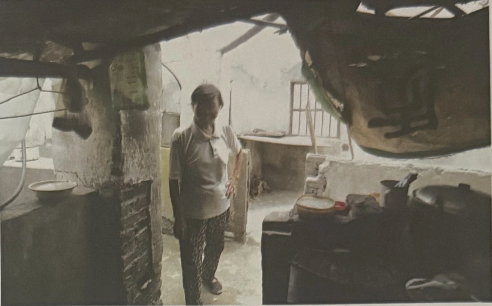
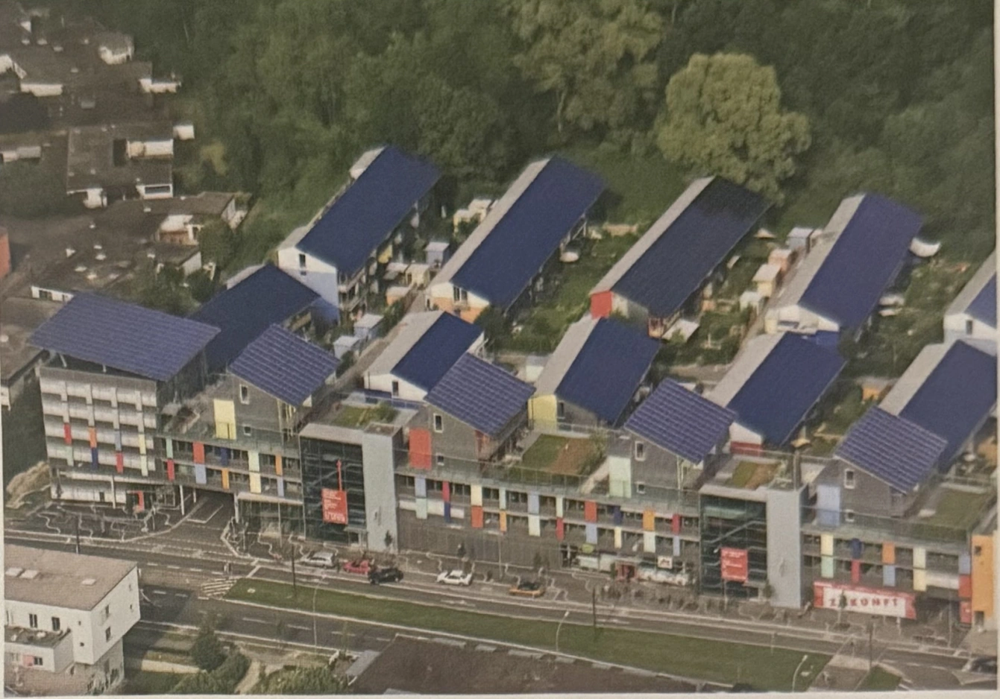

## The chapter at a glance {#chapter-overview}

**Central question:** Can we develop renewable energy resources to help sustain a thriving economy without adversely affecting the environment? [Book, p. 297.]

| Science | Issues | Solutions | Takeaway |
|---|---|---|---|
| Solar, wind, water, geothermal heat and biomass follow different conversion pathways. | Land, wildlife, rivers, food systems, material needs and the timing of supply remain important. | Improve siting and operation, protect ecological flows, choose feedstocks carefully and integrate demand, generation and storage. | Renewable describes resource renewal—not an absence of impacts. Evaluate a complete system in its setting. |

This complete lesson follows all eleven numbered sections of Chapter 10. It is a self-paced chapter course, not a transcript constrained to 50 minutes. The separate presentation summarizes the central question, mechanisms, issues, solutions and takeaways for a 50-minute class.

The opening Samsø example asks us to think about a community's energy portfolio and participation, not one device. An annual renewable-energy balance is not proof of an isolated system meeting every instant of demand. State the boundary: electricity or all energy, annual totals or hourly service, and local generation or exchange with a wider grid. Treat the book's account as a historical case. [Book, pp. 296–297.]

<nav class="v1-path" aria-label="Chapter 10 reading pathway"><a href="#chapter10-science">Science · 10.1–10.3</a><a href="#chapter10-issues">Issues · 10.4–10.7</a><a href="#chapter10-solutions">Solutions · 10.8–10.11</a></nav>

## Science · One label, different mechanisms {#chapter10-science}

### 10.1 Solar energy can be used as a heat source and to generate electricity

Solar energy can supply a service directly as heat or be converted into electricity. A building that admits winter sunlight and limits summer heat gain uses design to manage energy flows. A solar-water-heating system transfers absorbed energy to water or another fluid. Neither requires electricity generation as an intermediate step.

**Photovoltaic (PV) cells** absorb light in a semiconductor. The energy of absorbed photons can free charge carriers, and the device's internal electric field helps separate them; a connected external circuit delivers electrical energy. This is not a miniature steam engine. Clouds can reduce available light without making output necessarily zero, because diffuse sunlight can still reach a panel. Device temperature, shading and the system configuration also matter. [Book, pp. 298–301; [DOE photovoltaic-cell basics](https://www.energy.gov/cmei/systems/solar-photovoltaic-cell-basics).]

<figure class="mechanism" id="figure-photovoltaic">
<h4>Photovoltaics: light to electricity</h4>

<figcaption>Reconstructed illustration adapted from Molles &amp; Borrell, <em>Environment: Science, Issues, Solutions</em> (2016), Fig. 10.7, in §10.1. The drawing simplifies a silicon cell. <a href="https://www.energy.gov/cmei/systems/solar-photovoltaic-cell-basics">DOE photovoltaic-cell explanation</a>.</figcaption>
<a class="figure-open" href="../energy-assets/figures/photovoltaic.webp">Enlarge figure</a>
<ol>
<li data-focus="14,5,45,44"><strong>Absorb light</strong>Absorbed photons transfer energy to charge carriers in the semiconductor.</li>
<li data-focus="14,43,48,38"><strong>Separate charges</strong>The junction helps separate charge carriers so the illuminated cell can supply a voltage.</li>
<li data-focus="63,22,31,65"><strong>Deliver electrical energy</strong>A connected circuit allows current to flow through a load. No boiling water or turbine is involved.</li>
</ol>

The moving outline guides attention; it does not measure energy, fluid speed or system performance. Use the experiments for numerical comparisons.

</figure>

**Concentrating solar power (CSP)** uses mirrors to concentrate sunlight as heat. A heated fluid supports a thermal cycle that can drive a turbine and generator. Some designs store thermal energy for later use. Distinguish the collection of sunlight, the storage of heat and the generation of electricity: these are separate functions. A statement about cooling water at a thermal plant should not automatically be applied to a rooftop PV panel.

<figure class="mechanism" id="figure-solar-thermal">
<h4>Concentrating solar power: sunlight becomes heat</h4>

<figcaption>Reconstructed illustration adapted from Molles &amp; Borrell, <em>Environment: Science, Issues, Solutions</em> (2016), Fig. 10.6 and §10.8. This is one conceptual tower-and-storage arrangement; not every CSP plant uses salt storage.</figcaption>
<a class="figure-open" href="../energy-assets/figures/solar-thermal.webp">Enlarge figure</a>
<ol>
<li data-focus="3,4,32,78"><strong>Concentrate sunlight</strong>Mirrors direct sunlight to a receiver, where its energy heats a fluid.</li>
<li data-focus="27,30,28,59"><strong>Store or transfer heat</strong>In the illustrated arrangement, heated salt stores thermal energy and transfers heat to a separate power cycle.</li>
<li data-focus="52,33,45,51"><strong>Run a thermal power cycle</strong>Steam drives a turbine and generator, then condenses. Storage shifts heat use in time but does not create energy.</li>
</ol>

The moving outline guides attention; it does not measure energy, fluid speed or system performance. Use the experiments for numerical comparisons.

</figure>

**Check:** classify solar hot water, a PV-powered lamp and a mirror-based thermal power station. The services and conversion steps are different even though all use sunlight.

### 10.2 Wind, water, and geothermal energy add to the renewable energy portfolio

Uneven solar heating contributes to pressure differences and moving air. A wind turbine extracts part of that air's kinetic energy, turns a rotor and drives a generator. Wind speed is therefore a resource condition, not a promise of constant electrical output. Turbines have operating ranges, rated output limits and protective shutdown conditions. A turbine that has stopped in very strong wind illustrates a device constraint, not the absence of kinetic energy in the air. [Book, pp. 302–303.]

<figure class="mechanism" id="figure-wind-turbine">
<h4>Inside a wind turbine</h4>

<figcaption>Reconstructed illustration adapted from Molles &amp; Borrell, <em>Environment: Science, Issues, Solutions</em> (2016), Fig. 10.8. The geared turbine shown is one design; direct-drive turbines omit a gearbox. <a href="https://www.energy.gov/cmei/systems/how-do-wind-turbines-work">DOE: wind-turbine mechanisms</a>.</figcaption>
<a class="figure-open" href="../energy-assets/figures/wind-turbine.webp">Enlarge figure</a>
<ol>
<li data-focus="2,7,45,87"><strong>Moving air turns the rotor</strong>Aerodynamic lift and drag on shaped blades produce torque. A conventional turbine does not require a spinning Magnus cylinder.</li>
<li data-focus="43,33,28,36"><strong>Transmit mechanical power</strong>The shaft transfers rotation. In this geared example, the gearbox increases rotational speed for the generator.</li>
<li data-focus="70,25,27,51"><strong>Generate electricity</strong>The generator converts mechanical work into electrical energy. The resource experiment below explores why output has operating limits.</li>
</ol>

The moving outline guides attention; it does not measure energy, fluid speed or system performance. Use the experiments for numerical comparisons.

</figure>

#### Experiment 10.1: a resource is not a constant output {#renewable-conversion-lab}

**Question:** If sunlight or wind increases, does electrical output increase in the same way?

**Predict.** For two imaginary 1 MW systems, predict the effect of reducing sunlight from 100% to 50%. Then predict the effect of changing wind speed from 6 to 12 m/s, and from 12 to 25 m/s. Explain whether you expect a linear relationship in each case.

Without JavaScript, use the worked trials below. The interactive version animates a photovoltaic pathway and turbine and lets you vary sunlight and wind speed.

**Investigate.** Change one control at a time. Use **Play animation** to see the conversion pathways, but use the numerical outputs as your evidence. Rotation is a visual cue, not a measurement of real rotor speed.

| Trial | Sunlight | Wind speed | What to compare |
|---|---:|---:|---|
| A | 100% | 6 m/s | Record both outputs |
| B | 50% | 6 m/s | Isolate the sunlight effect |
| C | 50% | 12 m/s | Isolate the wind-speed effect |
| D | 50% | 25 m/s | Test an operating limit |

Worked results: why the responses differ

In A, PV output is 1,000 kW and wind output is approximately 111.1 kW. In B, PV falls to 500 kW while wind remains unchanged. In C, wind reaches 1,000 kW. In D, wind output is zero because this fictional machine reaches its protective cut-out threshold; PV remains at 500 kW.

The PV model assumes a proportional response to light under otherwise fixed conditions. The wind model includes a nonlinear increase, a rated-output limit and a cut-out threshold. Air contains kinetic energy above the threshold, but the machine is not operating to harvest it. Actual output depends on the specific device and conditions; these values are not a real turbine specification.

Do not infer annual generation from one instant. To estimate energy, we need the output over time. A single windy afternoon does not establish a yearly capacity factor.

For the physical mechanisms, compare the Department of Energy's explanations of [photovoltaic cells](https://www.energy.gov/cmei/systems/solar-photovoltaic-cell-basics) and [wind-turbine conversion](https://www.energy.gov/cmei/systems/how-do-wind-turbines-work). The [DOE turbine overview](https://www.energy.gov/articles/how-wind-turbine-works) also explains operating limits. The exact numerical curve above is an original teaching model.

Hydropower converts gravitational potential and kinetic energy in water into mechanical rotation and electricity. A reservoir can store water and shift some production in time, subject to inflow, ecological requirements and other uses. A run-of-river system usually has much less storage; diversion may still alter the river reach between intake and return. **Tides** arise from gravitational interactions, while **most surface-wave energy** derives from wind. “Renewable” does not imply an identical primary driver or identical controllability. [Book, pp. 304–306.]

<figure class="mechanism" id="figure-hydropower">
<h4>Hydropower: a useful height difference</h4>

<figcaption>Reconstructed illustration adapted from Molles &amp; Borrell, <em>Environment: Science, Issues, Solutions</em> (2016), Fig. 10.12. The schematic shows a reservoir-based plant; output depends on flow, hydraulic head and efficiency.</figcaption>
<a class="figure-open" href="../energy-assets/figures/hydropower.webp">Enlarge figure</a>
<ol>
<li data-focus="2,9,45,47"><strong>Water has gravitational potential energy</strong>A difference in water level provides hydraulic head. Both the height difference and the flow rate matter.</li>
<li data-focus="26,43,34,47"><strong>Flow drives a turbine</strong>Water passes through the penstock and turbine, transferring energy to the shaft.</li>
<li data-focus="51,23,24,48"><strong>Generate electricity, return water</strong>The generator converts rotation into electricity. Returning water downstream does not undo changes to flow timing, sediment or fish passage.</li>
</ol>

The moving outline guides attention; it does not measure energy, fluid speed or system performance. Use the experiments for numerical comparisons.

</figure>

Geothermal systems use heat within Earth, including heat associated with radioactive decay. They do not depend on daily sunshine. In **dry-steam** systems, steam drives a turbine directly; in **flash-steam** systems, a pressure reduction causes some hot water to vaporize; in **binary-cycle** systems, a heat exchanger transfers heat to a separate fluid with a lower boiling point. The geothermal water and secondary fluid need not mix. A useful design depends on local temperature and geology. [Book, pp. 306–307; [EIA geothermal explanation](https://www.eia.gov/energyexplained/geothermal/index.php).]

<figure class="mechanism" id="figure-geothermal">
<h4>Binary geothermal: heat crosses between fluids</h4>

<figcaption>Reconstructed illustration adapted from Molles &amp; Borrell, <em>Environment: Science, Issues, Solutions</em> (2016), Fig. 10.19. This is a binary-cycle plant, not a dry-steam or flash-steam plant. Well geometry and subsurface flow are schematic.</figcaption>
<a class="figure-open" href="../energy-assets/figures/geothermal.webp">Enlarge figure</a>
<ol>
<li data-focus="6,15,36,76"><strong>Bring geothermal heat to the surface</strong>Hot geothermal fluid carries energy from the reservoir to a heat exchanger.</li>
<li data-focus="29,10,49,47"><strong>Heat a separate working fluid</strong>Heat crosses the exchanger without requiring the two fluids to mix. The secondary fluid vaporizes and drives a turbine.</li>
<li data-focus="59,42,37,50"><strong>Condense and recirculate</strong>The working fluid condenses, while cooled geothermal fluid returns through an injection well. Sustainable operation depends on the reservoir and management.</li>
</ol>

The moving outline guides attention; it does not measure energy, fluid speed or system performance. Use the experiments for numerical comparisons.

</figure>

**Compare:** solar PV, a reservoir hydro plant and geothermal generation differ in resource availability and controllability. Avoid reducing these differences to “renewable energy is always intermittent.” Ask which source, which site and which operating constraint.

### 10.3 Biomass fuels represent stored chemical energy

Photosynthesis stores solar energy in biological material. Burning wood or other biomass releases chemical energy as heat. Biomass is renewable only when its production and management support renewal at the relevant rate; a growing resource can still be depleted by harvesting too quickly.

Liquid biofuels require additional conversion. Sugars can be fermented to produce ethanol. Cellulosic feedstocks first require treatment that makes sugars available for fermentation, followed by separation of the product. Biodiesel follows a different processing route from fats or oils. The energy, water, nutrients and land required for these steps belong in the assessment—not just the energy in the final fuel. [Book, pp. 307–309.]

<figure class="mechanism" id="figure-cellulosic-ethanol">
<h4>Cellulosic ethanol: making sugars accessible</h4>

<figcaption>Reconstructed illustration adapted from Molles &amp; Borrell, <em>Environment: Science, Issues, Solutions</em> (2016), Fig. 10.23. Process vessels and the molecular inset are conceptual; this is not a molecular-structure or engineering diagram.</figcaption>
<a class="figure-open" href="../energy-assets/figures/cellulosic-ethanol.webp">Enlarge figure</a>
<ol>
<li data-focus="3,12,34,78"><strong>Prepare plant material</strong>Pretreatment makes cellulose more accessible. The feedstock still carries land, water and harvesting impacts.</li>
<li data-focus="33,8,25,80"><strong>Release fermentable sugars</strong>Enzymes break cellulose into sugars that microorganisms can use.</li>
<li data-focus="57,11,40,80"><strong>Ferment and recover ethanol</strong>Microorganisms convert sugars into ethanol. Separating the fuel also requires energy and belongs in the life-cycle accounting.</li>
</ol>

The moving outline guides attention; it does not measure energy, fluid speed or system performance. Use the experiments for numerical comparisons.

</figure>

Algae and nonfood feedstocks offer possibilities, but a promising laboratory pathway is not automatically a low-impact commercial system. Growing, harvesting and processing the feedstock can be demanding. Identify which limitation a proposed improvement actually addresses.

#### Conversion-pathway game {#conversion-pathway-game}

Offline challenge: explain the next step after sunlight reaches a PV cell, mirrors heat a fluid, geothermal water enters a binary plant, cellulose enters ethanol processing, and tidal water begins moving.

Offline answers and discussion

PV uses a semiconductor and separated charge carriers. CSP supplies a thermal power cycle. Binary geothermal transfers heat to a separate working fluid. Cellulose must be converted into accessible sugars before fermentation. Tidal motion depends directly on gravitational interactions. Compare the physical conversion in each answer, not simply its renewable label.

## Issues · Renewable is not impact-free {#chapter10-issues}

### 10.4 Solar power remains costly and can damage the environment

This is the book's official section heading. Its cost wording reflects the publication context of **2016**, not a claim about today's prices or rankings. The durable lesson is to specify what a cost or impact includes: a device, an installed project, energy delivered, integration requirements, or an entire life cycle.

Large solar installations can alter habitats and land use. Desert ecosystems are not empty simply because vegetation is sparse. Water demand depends strongly on whether the installation is PV or a thermal plant and on its cooling design. Land preparation, roads and transmission connections extend the footprint beyond the collector area. [Book, pp. 310–312.]

**Energy return on energy invested (EROEI)** compares energy delivered with energy used to obtain it. The denominator is invested energy—not money and not incoming sunlight. State a common boundary before comparing two values: do both include manufacturing, construction, operation, replacement and decommissioning? The book's marginal definition supports the returned/invested ratio used here; an inverted sentence in the running text should not reverse it.

#### Net-energy experiment {#energy-return-lab}

Keep delivered energy at 100 units and increase the investment. Predict both the ratio and the net amount before moving the slider.

Without JavaScript: EROEI = delivered energy ÷ invested energy; net energy = delivered − invested. For delivery of 100 and investment of 10, the ratio is 10 and net energy is 90 units.

Worked trials and limits

For delivery of 100 units, investments of 10, 25, 100 and 125 give EROEI values of 10, 4, 1 and 0.8, respectively. Corresponding net energy is 90, 75, 0 and −25 units. At a ratio of one, this boundary leaves no net energy. These invented examples are not ratings for specific technologies. An attractive ratio does not by itself establish acceptable wildlife effects, affordability or supply at the right time.

### 10.5 Wind turbines and transmission lines kill birds and bats

Wildlife effects can involve collisions and changes in habitat use. Species, migration routes, season, weather, rotor operation and transmission layout influence exposure. A national total does not establish the effect on a particular local population, and a count without search effort or detection information can be misleading. [Book, pp. 312–314.]

Separate **hazard**, **exposure** and **population consequence**. A moving rotor presents a hazard; animals' use of the site influences exposure; mortality relative to population size and reproductive capacity affects the biological consequence. This chain suggests measurements and interventions more precisely than saying that wind is either harmless or unacceptable.

**Design a study:** compare operation under a curtailment rule with a suitable comparison condition. Measure fatalities with appropriate detection corrections, energy generated, and relevant weather or seasonal conditions. An intervention should be evaluated on both its ecological result and its energy tradeoff.

### 10.6 Hydroelectric development can have multiple environmental and social impacts

Hydroelectric projects can alter flow timing, sediment transport, water temperature, oxygen conditions and fish movement. A reservoir transforms a flowing-river habitat and can inundate land. Effects propagate upstream and downstream, so the project boundary cannot stop at the dam wall.

The chapter's Three Gorges and Belo Monte examples connect electricity benefits to displaced communities and changed livelihoods. Treat these as historical case studies, not current project-status reports. Ask who participates in decisions, how alternatives are compared and whether compensation addresses the actual losses. A benefit to distant electricity users does not cancel a local burden by definition. [Book, pp. 314–315.]

<figure class="mechanism mechanism-static" id="figure-reservoir-community">
<h4>The human side of a reservoir</h4>

<figcaption>Molles &amp; Borrell, <em>Environment: Science, Issues, Solutions</em> (2016), Fig. 10.34, reproduced from the supplied Chapter 10 presentation. A resident in a partly demolished home before inundation by the Three Gorges reservoir. Displacement can involve losing a home, income, access to land and community ties; a photograph alone cannot establish every outcome.</figcaption>
<a class="figure-open" href="../energy-assets/figures/reservoir-community.webp">Enlarge figure</a>
</figure>

Reservoir greenhouse-gas effects vary with site and conditions. “No fossil fuel burned at the turbine” is not equivalent to “no life-cycle emissions.” The same boundary discipline used in Chapter 9 applies here.

### 10.7 Biofuel development can reduce food supplies and harm the environment

Land allocated to a fuel crop may compete with food production or other uses. Expansion can cause direct or indirect land-use change; fertilization, water use and pesticide application add further pathways. A fuel crop that regrows does not automatically reverse the loss of a diverse ecosystem or its stored carbon.

The chapter discusses food–fuel tensions as one contributor within larger food systems. Do not attribute every food-price change to biofuels alone: harvests, demand, markets and other conditions also matter. A causal argument needs more than two trends moving together. [Book, pp. 315–317.]

**Counterfactual question:** what would happen to the land or residue without fuel production? A material called “waste” may already protect soil, return nutrients or support another use. Full accounting compares the new pathway with that alternative, not with an imaginary world in which the material has no function.

## Solutions · Match the intervention to the impact {#chapter10-solutions}

### 10.8 Smart solutions to issues associated with solar power are under development

Different solutions address different constraints. Rooftops, parking areas and previously disturbed sites may reduce new habitat conversion. Dry or hybrid cooling can reduce water use in appropriate thermal systems, with design and performance tradeoffs. Better connections and project processes can address deployment barriers, but policy examples in the book are historical rather than current incentive advice. [Book, pp. 317–319.]

<figure class="mechanism mechanism-static" id="figure-rooftop-solar">
<h4>A siting alternative on existing buildings</h4>

<figcaption>Molles &amp; Borrell, <em>Environment: Science, Issues, Solutions</em> (2016), Fig. 10.40, reproduced from the supplied presentation. Rooftop PV in Freiburg, Germany. Suitable existing roofs can reduce pressure to clear intact habitat; structural suitability, shading and grid connections still need assessment.</figcaption>
<a class="figure-open" href="../energy-assets/figures/rooftop-solar.webp">Enlarge figure</a>
</figure>

Thermal storage stores heat for later conversion; batteries store energy in another form. Neither creates additional primary energy. Storage changes timing and incurs losses or other constraints. Pairing generation with flexible demand can also improve timing: operating a suitable load during abundant supply is not the same as reducing its total energy use.

**Choose a match:** if the problem is desert habitat loss, an evaluation of disturbed-land alternatives addresses the mechanism more directly than a larger battery. If the problem is evening demand after sunset, the timing of supply and demand becomes central.

### 10.9 Less damaging wind-generation strategies are under development

Siting can avoid sensitive habitats and movement corridors. Operation can be adjusted during periods of elevated wildlife exposure. The chapter describes studies using higher starting wind speeds and other selective curtailment strategies to reduce bat mortality. These are empirical, site-specific comparisons, not a universal guarantee or a single permanent percentage for every wind farm. [Book, pp. 319–321.]

Repowering, transmission routing and line treatments can address additional issues. A disturbed site still needs ecological assessment; “already altered” does not mean “no species use it.” A strong plan states the operating rule, monitoring method, acceptable response threshold and who will revise the rule when evidence changes.

### 10.10 Downsizing can mitigate the impacts of hydroelectric development

Smaller or run-of-river projects can avoid some large-reservoir impacts. Retrofitting suitable existing structures may avoid building a new barrier. But size alone is not an impact assessment: a diversion can reduce flow in a bypassed reach, and many small projects can produce cumulative effects. [Book, pp. 321–323.]

Protecting ecological flows, sediment movement and fish passage requires attention to the actual river and species. A device advertised as fish-friendly still needs evidence under relevant conditions. Ask how operation changes across seasons and droughts, not just how it performs at one flow rate.

**River negotiation:** assign teams to electricity supply, aquatic ecology and downstream water users. Agree on the information needed to set a minimum-flow rule. Explain what would happen when water is insufficient to meet all desired uses. The exercise is about explicit priorities and evidence—not inventing a universally safe percentage.

### 10.11 Less damaging, more efficient biofuels are under development as alternatives to oil-based fuels

Cellulosic materials, perennial crops, residues and selected wastes may reduce some competition with food crops or some land-use burdens. The advantage depends on the feedstock, location, processing and alternative use. Residue removal must account for soil protection and nutrients; perennial production still needs a land-use comparison. [Book, pp. 323–325.]

Algae can incorporate carbon dioxide during growth, but burning the resulting fuel returns carbon to the atmosphere. Temporary uptake is not permanent sequestration. Energy used in cultivation, harvesting, drying and conversion affects the net result. A more efficient process should be demonstrated with a consistent energy and material balance.

The solution is therefore not to attach a “sustainable” label to a feedstock category. Screen the full pathway, protect high-value ecosystems, improve processing, monitor effects and revise the choice if the promised advantage fails to appear.

#### Environmental-safeguards challenge {#safeguards-game}

Offline challenge: match habitat-sensitive solar siting, targeted wind curtailment, ecological river flows and careful feedstock selection to their respective impact pathways.

Offline answers and extension

For solar habitat loss, evaluate rooftops and disturbed land. For the stated low-wind bat-exposure problem, test targeted curtailment and monitor it. For a dewatered river reach, protect ecological flow and fish passage. For biofuel-driven habitat conversion, screen feedstocks and land use while accounting for soil needs. Add one measurable indicator to each answer; no safeguard is established merely by naming it.

## Chapter takeaways {#chapter-takeaways}

1. **Name the conversion:** PV, solar heat, wind, water, geothermal and biomass do not work in the same way.
2. **Keep the denominators straight:** efficiency, EROEI and capacity factor answer different questions.
3. **Distinguish totals from timing:** enough energy over a day does not guarantee supply in each period.
4. **Match solutions to impacts:** siting, curtailment, ecological flows and feedstock choices act on different mechanisms.
5. **Evaluate the whole system:** include land, water, wildlife, communities, life-cycle boundaries and monitoring—not only electrical output.

**Answer the central question:** renewable resources can support energy services while reducing some burdens of fossil systems, but no project is automatically free of environmental effects. A defensible transition combines efficient services, appropriate technology and siting, participation, ecological safeguards and evidence-based revision. “Lower impact under these conditions” is a stronger scientific claim than “impact-free.”

## Investigation studio: extend the chapter {#investigation-studio}

The following experiments add worked calculations, animated conversion and storage, and a community-design challenge. They deepen the chapter beyond the presentation. Work at your own pace, record predictions before changing controls, and distinguish simulated outcomes from measured evidence.
